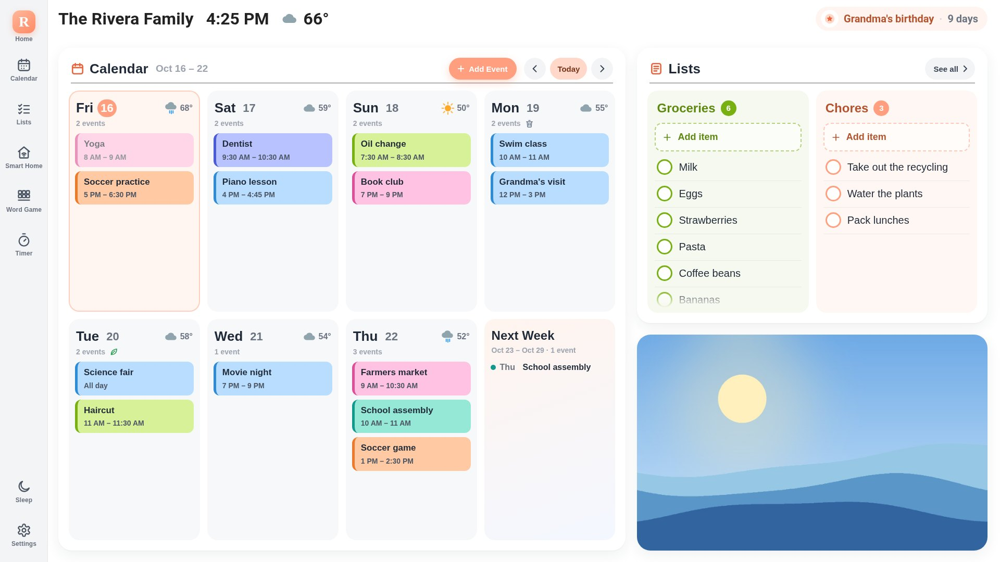
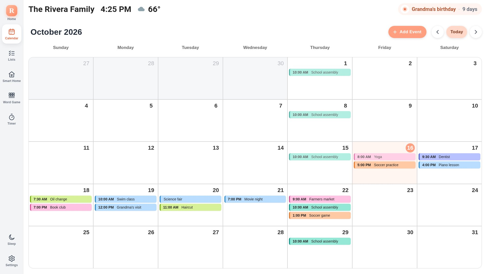
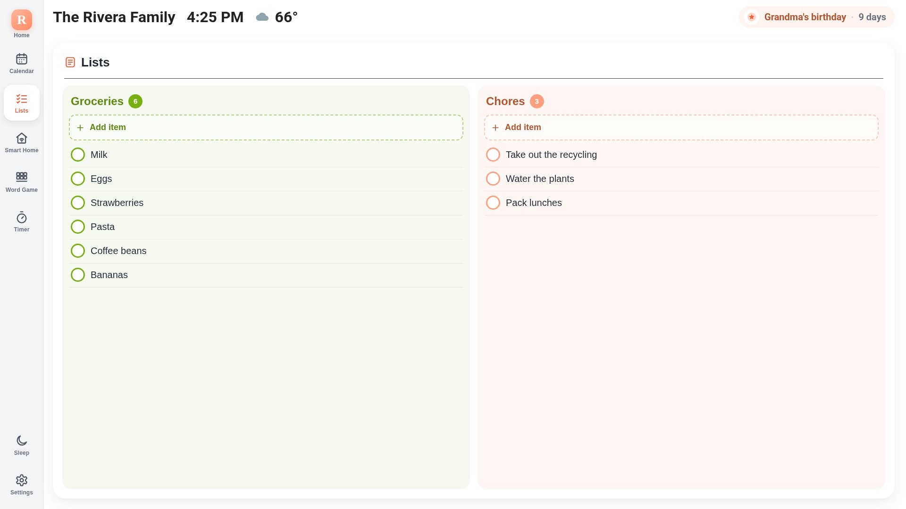
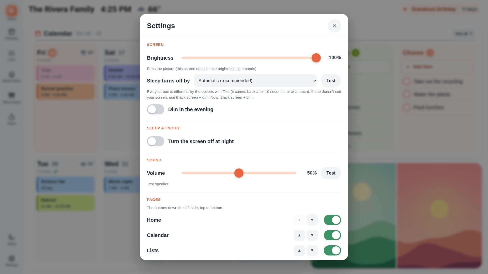
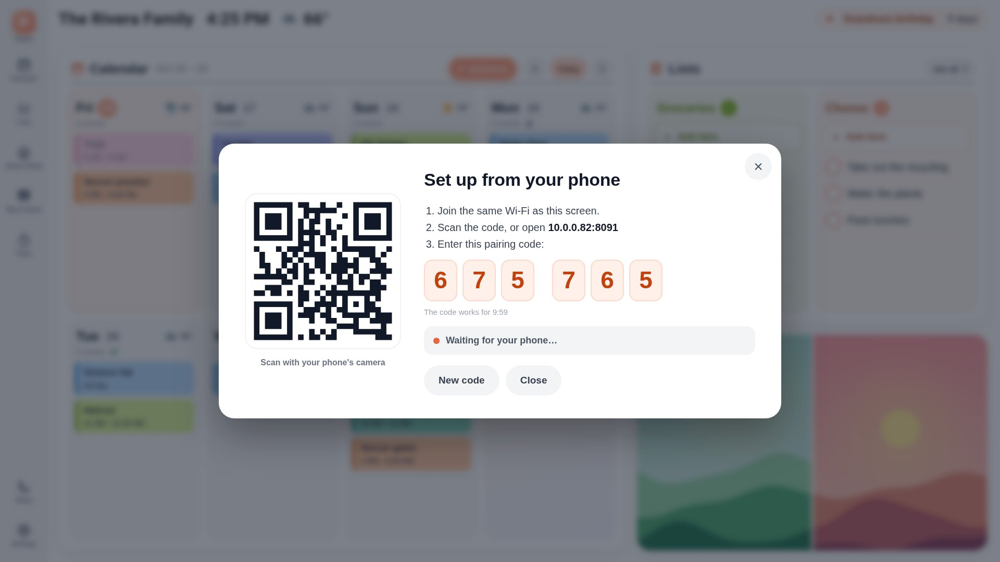
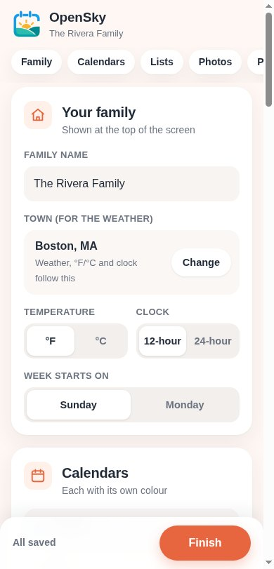

# OpenSky


A friendly family wall calendar and home dashboard for a Raspberry Pi touchscreen — the week ahead, shared lists,
timers, photos, weather and smart-home controls on one screen. Built on [MagicMirror²](https://magicmirror.builders/).

> **v1.0** — what's in it: [CHANGELOG.md](CHANGELOG.md). Where it's heading: [PLAN.md](PLAN.md).

**Watch the intro video** (YouTube):

[](https://www.youtube.com/watch?v=qnbN82BGLP4)



<table><tr>
<td></td>
<td></td>
</tr><tr>
<td></td>
<td></td>
</tr></table>
<p align="center"></p>

<sub>Screenshots use a made-up family and demo pictures (`node tools/harness.js tools/demo/screenshots.js`).</sub>

## What you get
- **Home:** the week ahead with everyone's events in their colours, weather, trash-day icons, your lists and a photo.
- **Calendar:** month / two-week / week view; tap to see, add, edit or delete events.
- **Lists:** to-dos and groceries — kept on the Pi, or in Todoist. Check off with Undo.
- **Timer**, holiday & birthday countdown, your team's game day, sleep button, photos from a folder, USB stick or Immich.
- Works with Google, Outlook, iCloud, Fastmail, Nextcloud or any calendar link — or no account at all.
- **Add-on — Music:** the screen becomes an AirPlay and Spotify speaker, with a Music page
  ([docs/music.md](docs/music.md)): `opensky addon music`.

## Install
On a Raspberry Pi 4/5 with Raspberry Pi OS (64-bit, desktop) and a touchscreen:
```bash
git clone https://github.com/CosmoJM/OpenSky.git ~/OpenSky && cd ~/OpenSky && ./install.sh
```
Step by step: [docs/install.md](docs/install.md) · settings: [docs/configure.md](docs/configure.md) ·
Google Calendar with editing: [docs/google-calendar.md](docs/google-calendar.md) ·
help: [docs/troubleshooting.md](docs/troubleshooting.md)

## Docs
- **For people:** [`docs/`](docs/README.md).
- **Contributing:** [CONTRIBUTING.md](CONTRIBUTING.md).
- **For AI assistants:** start with [`AGENTS.md`](AGENTS.md).
