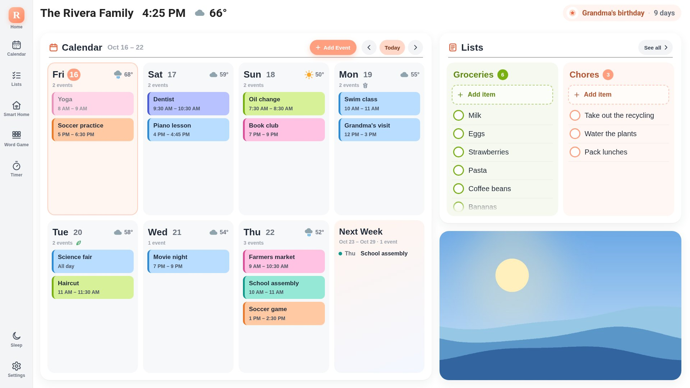
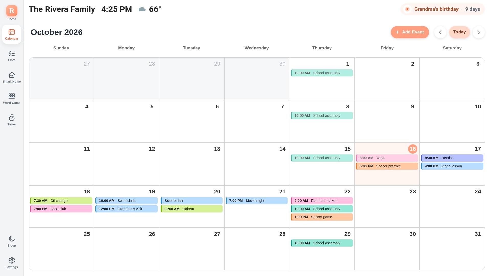
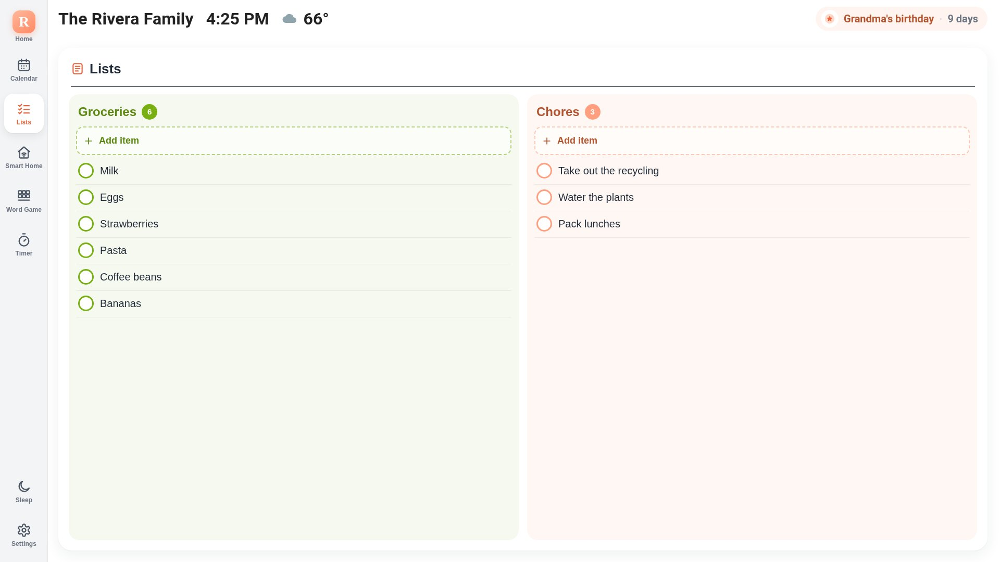
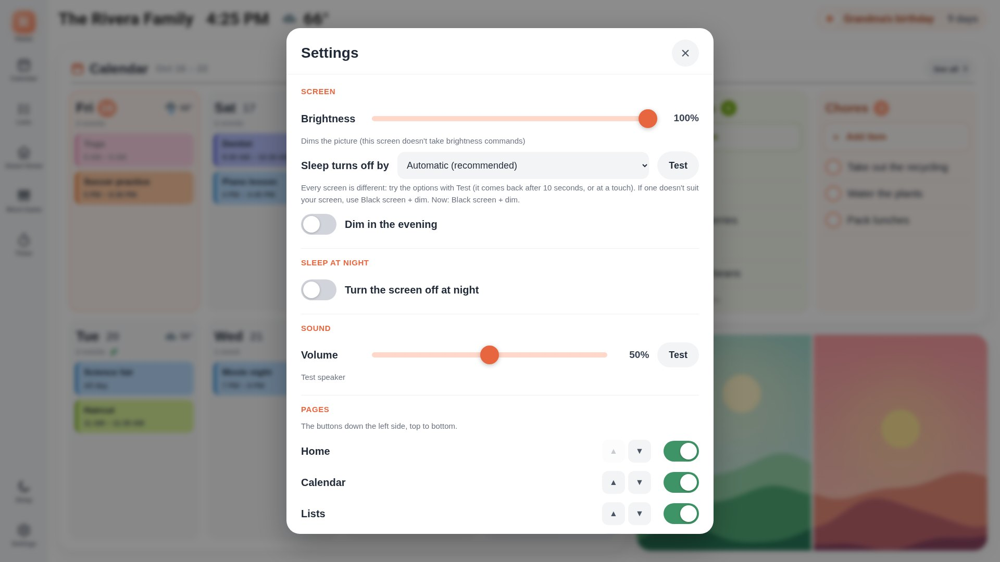
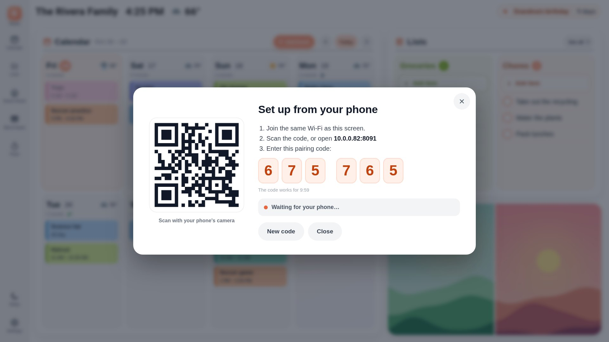

A friendly family wall calendar and home dashboard for a Raspberry Pi touchscreen — the week ahead, shared lists,
timers, photos, weather and smart-home controls on one screen. Built on [MagicMirror²](https://magicmirror.builders/).

[Get started: Install](install.md){: .button }

**Watch the intro video** (YouTube):

## What you get
- **Home:** the week ahead with everyone's events in their colors, weather, trash-day icons, your lists and a photo.
- **Calendar:** month / two-week / week view; tap to see, add, edit or delete events.
  - Works with Google, Outlook, iCloud, Fastmail, Nextcloud or any calendar link — or no account at all.
- **Lists:** to-dos and groceries — kept on the Pi, or in Todoist. Check off with Undo.
- **Timer**, holiday & birthday countdown, your team's game day, sleep button, photos from a folder, USB stick or Immich.
- **Add-on — Music:** the screen becomes an AirPlay and Spotify speaker, with a Music page
  ([details](music.md)): `opensky addon music`.
